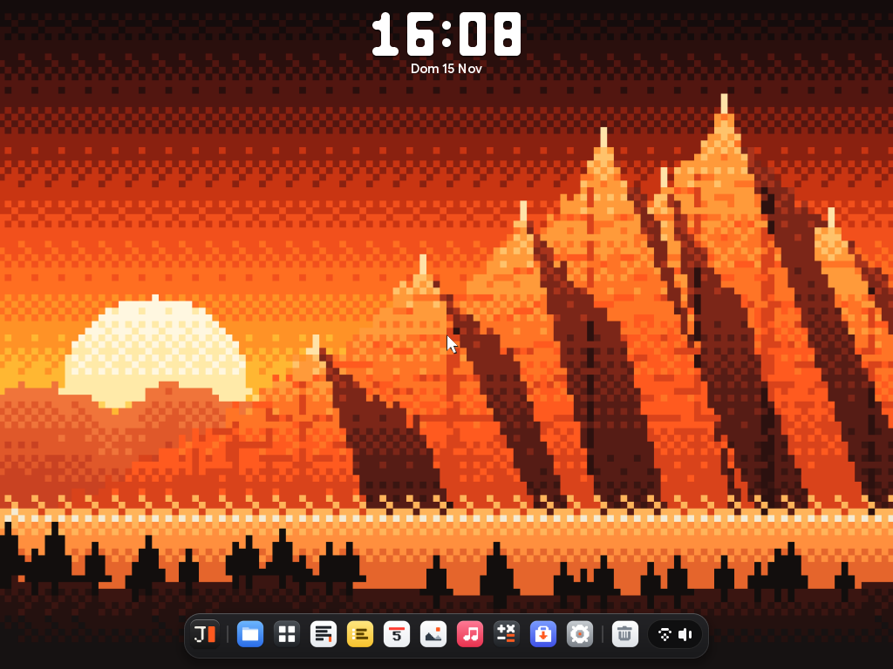
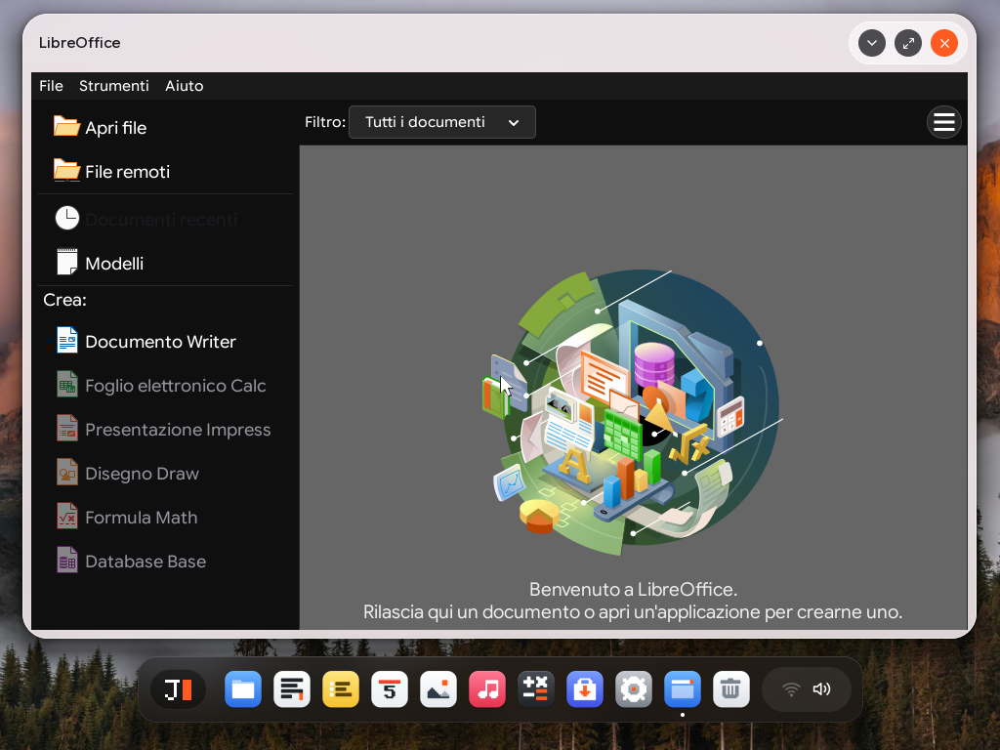
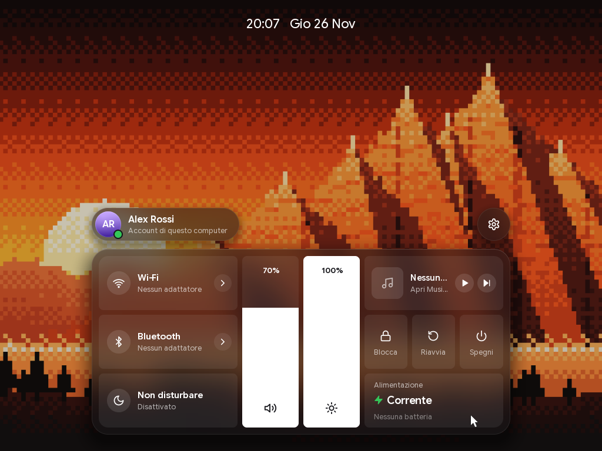
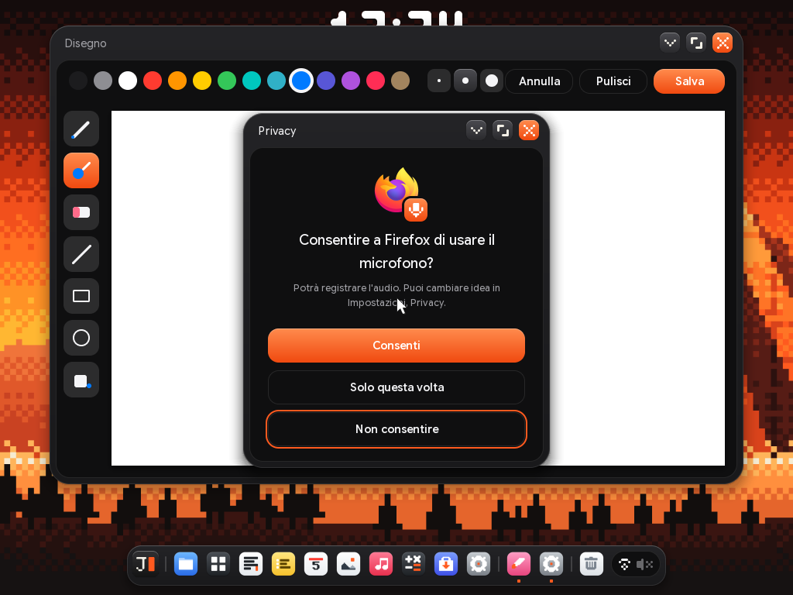
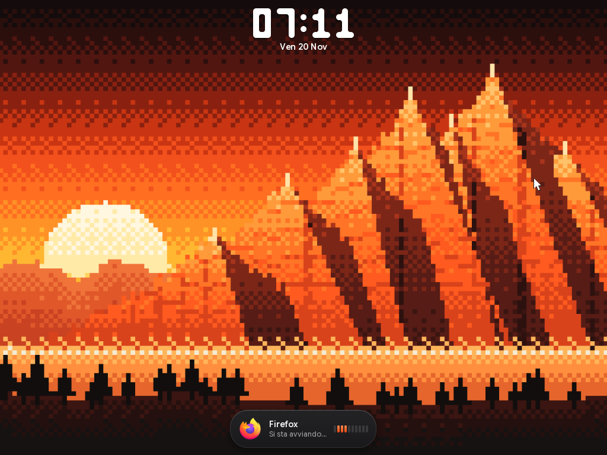

justOS: un sistema operativo per PC x86-64 scritto da zero in Rust, su cui girano Firefox, i programmi Linux e quelli Windows.

## Novità della 0.13.0

- **Il Negozio ha programmi veri**: LibreOffice Writer, GIMP, Inkscape, Thunderbird, il Visualizzatore di documenti, Gnumeric, Xournal++, Mousepad, Geany, FileZilla, Remmina, Ristretto e il Solitario arrivano dall'archivio firmato di Debian, con tutto quello che serve. Il Negozio mostra quanto pesano e l'avanzamento in percentuale; finita l'installazione il programma è nel launcher con il suo nome e la sua icona. **Rimuovi** toglie il programma e i pacchetti che erano arrivati con lui. LibreOffice e Thunderbird sono in italiano.
- **Molta meno memoria**:
  - la scrivania appena accesa usa circa 60 MiB;
  - con una dozzina di programmi aperti e chiusi resta sotto i 250 MiB;
  - la cache dei dischi si restituisce da sola quando la memoria serve ai programmi.
- **Firefox più leggero**: niente processi preparati in anticipo, un processo per sito, le estensioni nel processo principale, le schede scaricate quando la memoria scarseggia. Niente telemetria e niente storie sponsorizzate nella nuova scheda.
- **Wine più leggero e più veloce da preparare**: le DLL dei programmi Windows sono alleggerite, e la preparazione occupa 335 MiB invece di 1,4 GiB e richiede circa un minuto e un quarto invece di un minuto e mezzo.
- **Programmi Linux più compatibili**:
  - memoria condivisa e semafori System V, che molti programmi audio e Qt usano;
  - gli script d'installazione dei pacchetti Debian funzionano (debconf, ucf, gli aggiornamenti delle cache di icone, font e schemi);
  - i programmi Qt disegnano direttamente sullo schermo di justOS;
  - i giochi in /usr/games si trovano;
  - c'è /proc/version.
- Nel Terminale `uninstall <nome>` rimuove anche i pacchetti Debian, e `install <nome>` mostra la percentuale.
- Non ancora: VLC (non parte come amministratore, e per ora i programmi Linux lo sono) e Audacity (si chiude dopo la schermata d'avvio).

## Novità della 0.12.0

- **La barra dinamica**: in basso al centro c'è una sola barra che cambia forma. È il dock con le app e lo stato, e con un'animazione diventa il **centro di controllo** (Wi-Fi e Bluetooth con le loro pagine, Non disturbare, volume, luminosità, musica, Blocca, Riavvia, Spegni), l'indicatore del **volume** e della luminosità, le **notifiche**, il **player musicale**, la conferma di spegnimento e la ricerca del **launchpad**. Il logo apre il launchpad; il clic destro sul logo apre il menu di sistema.
- **Nuova schermata di blocco**: un tastierino se la password è un PIN di 4–8 cifre, altrimenti il campo della password.
- **Finestre nuove**: cornice chiara smerigliata, pulsanti riduci, schermo intero e chiudi in alto a destra, ridimensionamento da bordi e angoli, riduzione «genie» verso l'icona nel dock. Doppio clic sulla barra del titolo per ingrandire; con lo **schermo intero** la barra si nasconde e torna portando il mouse in basso o premendo da solo il tasto Windows.
- **Avvio delle app**: mentre un'app si apre la sua icona saltella nel dock, senza notifiche. Se prima va preparato l'ambiente per i programmi Windows, la barra si trasforma e mostra l'avanzamento, il tempo che manca e Annulla (o Riprova se qualcosa va storto).
- **Nuovo sfondo predefinito**: «Enrosadira», le Dolomiti al tramonto.
- Spariscono il vecchio dock, l'isola, il vecchio centro di controllo e i pannelli; con loro le impostazioni «Dock compatto» e «Ingrandimento icone».

## Novità della 0.11.0

- **JustOS Connect**: il telefono Android entra nel sistema. Scarica `justos-connect.apk` qui sotto (Android 8 o più recente), aprila sulla stessa rete del computer, tocca il tuo PC e scrivi il codice di sei cifre che compare nella finestra **JustOS Connect**. Da quel momento:
  - i **file** passano in entrambe le direzioni (sul telefono anche da *Condividi → JustOS Connect*; sul computer arrivano in *Scaricati*);
  - lo **schermo** del computer si vede sul telefono e si tocca per spostare il puntatore;
  - il telefono fa da **trackpad e tastiera**: un dito muove, un tocco clicca, due dita scorrono, con frecce, Esc, F1–F12 e volume;
  - **notifiche**, **batteria** e **appunti** del telefono arrivano sul computer, e dal computer si fa **squillare** il telefono per ritrovarlo.
  Tutto è cifrato (ECDH P-256 e AES-256-GCM). Nel Terminale c'è anche `connect`. Abbina il telefono sulla rete di casa, non su un Wi-Fi pubblico.
- **Bluetooth**: tastiere e mouse, classici e LE, con l'associazione da **Impostazioni → Bluetooth**; driver per gli adattatori USB e per i Realtek come l'RTL8852BE. Provato su un controller emulato.
- **Wi-Fi**: ricerca delle reti, WPA2 e WPA3 e connessione automatica, provate con un access point simulato. Il driver per la Realtek RTL8852BE carica il firmware ma non si collega ancora.

## Novità della 0.10.0

- **Permessi come su un telefono**: le app non ricevono più nessun permesso quando le installi. La prima volta che una vuole una cartella, la rete, la fotocamera, il microfono o mandare notifiche, compare un popup al centro della sua finestra con *Consenti*, *Solo questa volta* e *Non consentire* (già selezionato, anche con Esc). Dopo due *Non consentire* di fila l'app non chiede più. In **Impostazioni → Privacy** vedi ogni permesso e ogni app, con un interruttore per cambiare idea e *Chiedi di nuovo*.
- **Anche Firefox chiede il microfono**, con il suo nome e la sua icona, come i programmi Linux e Windows.
- **Il microfono funziona**: la scheda audio registra, e Firefox, `parec` e i programmi Windows ricevono il suono.
- **I programmi Windows hanno l'audio**: con Wine suonano (WASAPI e waveOut) e registrano.
- **I pacchetti `.deb` portano con sé quello che gli serve**: con un doppio clic justOS cerca nell'archivio di Debian le dipendenze che mancano, ti dice cosa aggiunge («Servono anche 9 pacchetti, 9,7 MB») e le installa. L'indice è verificato con la firma di Debian e ogni file con la sua impronta SHA-256. Nel Terminale c'è anche `deb get <nome>`: `deb get figlet`, `deb get cowsay`.
- Gli script che iniziano con `#!` (Perl, Python, shell) partono dal Terminale.

## Novità della 0.9.1

- **I programmi Linux hanno l'audio**: Firefox (YouTube, i siti, i suoni delle pagine) suona attraverso un piccolo server PulseAudio dentro il kernel, mescolato ai suoni di sistema e al volume delle Impostazioni. Senza scheda audio i programmi non si bloccano.
- **Firefox si presenta ai siti come Firefox per Windows**: le pagine di download propongono la versione `.exe`, che si avvia con un doppio clic grazie a Wine.
- I pacchetti `.deb` di Debian si installano con un doppio clic (o `deb install` nel Terminale), se le loro dipendenze sono già nel sistema.

## Novità della 0.9.0

- **La barra si trasforma**: invece di aggiungere una seconda barra, il dock stesso diventa un'isola al centro in basso per quello che succede (una notifica, il volume o la luminosità, un programma che si avvia, una canzone o un timer appena partiti, un timer che suona). Appena ci passi sopra con il puntatore torna la barra delle app; quando te ne vai l'isola ricompare.
- **Il dock non scatta più**: passandoci sopra, lo sfondo resta fermo e le icone crescono sul posto.
- **Più monitor**: con una scheda video che ne gestisce più di uno (per ora virtio-gpu nelle macchine virtuali), la scrivania si allarga su tutti; orologio e dock stanno sul monitor principale, le finestre passano da uno all'altro e si ingrandiscono sul loro. In Impostazioni → Schermo si sceglie il principale, l'ordine o la duplicazione, e la scelta resta.
- **Firefox apre le schede anche con 1 GiB di memoria**: un processo figlio condivide le pagine del padre finché uno dei due non scrive (`fork` copy-on-write), invece di copiarle tutte subito.
- **Firefox si chiude davvero**: prima, alla chiusura, restava bloccato un minuto e poi si fermava con un errore; ora esce da solo.
- **Sospensione anche sui portatili senza S3** (Modern Standby): s2idle, con i dispositivi fermi, lo schermo nero e i processori nel loro stato di riposo più profondo; si risveglia con il tasto di accensione, il coperchio, la tastiera o la sveglia.
- **Anteprime in File**: le immagini PNG, JPEG, GIF e QOI si vedono come miniature; il Visualizzatore apre anche PNG, JPEG e GIF.
- **La ricerca guarda anche dentro i file**: con Ctrl+Spazio, dopo i risultati per nome, la sezione *Contenuto* mostra i file di testo che contengono quello che scrivi, con la riga trovata.
- **Selettore di file dei programmi GTK** (Firefox compreso): si apre nella cartella home invece che su "Recenti" vuoto, i file recenti funzionano e non c'è più il Cestino che dava errore; le impostazioni dei programmi GTK restano da un avvio all'altro.
- **`help` del Terminale in italiano.**
- **Firefox, GTK e Wine in italiano**: menu, finestre di dialogo e messaggi dei programmi Linux e Windows sono tradotti; date e numeri seguono le regole italiane, e Firefox controlla l'ortografia in italiano.
- **Gli aggiornamenti arrivano da justapps-it**: l'indice firmato degli aggiornamenti si è spostato nella nuova casa del progetto. Chi ha installato la 0.8 vede l'annuncio della 0.9 in Info sistema, ma deve scaricarla a mano; dalla 0.9 in poi gli aggiornamenti si installano da soli.

## Cosa non va ancora

- Dall'archivio di Debian arrivano solo i pacchetti della release (trixie): gli aggiornamenti di sicurezza usciti dopo non ancora, perché quegli archivi sono compressi in xz.
- La fotocamera non è ancora disponibile per i programmi Linux.
- Molti programmi Windows a 32 bit e quelli grandi (Steam, per esempio) si fermano: la compatibilità è agli inizi.
- Il Wi-Fi non funziona ancora su una scheda vera (il driver RTL8852BE non è finito), il Bluetooth è provato solo su un controller emulato, l'audio Bluetooth manca. Manca anche l'accelerazione grafica: sulle schede video vere (Intel, AMD, nVidia) si usa il framebuffer del firmware, alla risoluzione scelta dal firmware, con un solo monitor.
- La sospensione s2idle è provata in QEMU, non ancora su portatili veri; la retroilluminazione resta accesa (lo schermo diventa nero).
- L'installazione su disco è provata in QEMU, non ancora su hardware vero; niente Secure Boot, dischi con settori da 4K o più grandi di 2 TiB.
- Lo stato di ogni driver è in [docs/driver.md](https://github.com/justapps-it/justOS/blob/main/docs/driver.md#hardware-supportato), cosa manca e in che ordine nella [roadmap](https://github.com/justapps-it/justOS/blob/main/docs/roadmap.md).

## File

| File | Cosa farne |
|---|---|
| `justos-img.zip` | **Immagine di disco** (scompattata 5 GiB, BIOS e UEFI), con Firefox e Wine: si scrive su una chiavetta USB da almeno 8 GB (balenaEtcher, Rufus in modalità DD, `dd`) per avviare un PC vero, o si usa come disco di una macchina virtuale. Secure Boot va disattivato. |
| `justos.iso` | **CD live**: si avvia in una macchina virtuale o da un CD, con BIOS o UEFI, senza disco rigido. Il sistema gira in memoria: le modifiche si perdono allo spegnimento. Non ha Firefox né Wine. |
| `justos-connect.apk` | **JustOS Connect** per Android 8 o più recente: si installa sul telefono (consentendo l'installazione da fonti sconosciute). |
| `SHA256SUMS` | le impronte dei file |

## Provarlo

- **QEMU**, immagine di disco: `qemu-system-x86_64 -m 2G -smp 4 -drive file=justos.img,format=raw -device ich9-intel-hda -device hda-output` (con `-accel kvm` su Linux o `-accel whpx` su Windows va molto più veloce).
- **QEMU**, CD live: `qemu-system-x86_64 -m 1G -cdrom justos.iso`
- **VirtualBox**: nuova macchina "Other/Unknown (64-bit)", nessun disco, `justos.iso` nel lettore CD.

Al primo avvio justOS fa qualche domanda (tema, tastiera, account), poi apre la scrivania. Documentazione nel [README](https://github.com/justapps-it/justOS#readme).
