<div align="center">


### Un sistema operativo per PC x86-64, scritto da zero in Rust.

Boot loader per BIOS e UEFI, kernel, file system, driver e interfaccia
grafica: tutto progettato apposta. E sopra ci girano Firefox, i programmi
Linux e quelli Windows.

[](https://github.com/justapps-it/justOS/actions/workflows/build.yml)
[](LICENSE)
[](https://www.rust-lang.org)

[Provalo](#provalo) ·
[Funzioni](#funzioni) ·
[Stato del progetto](#stato-del-progetto) ·
[Documentazione](#documentazione) ·
[Roadmap](docs/roadmap.md)

<br>

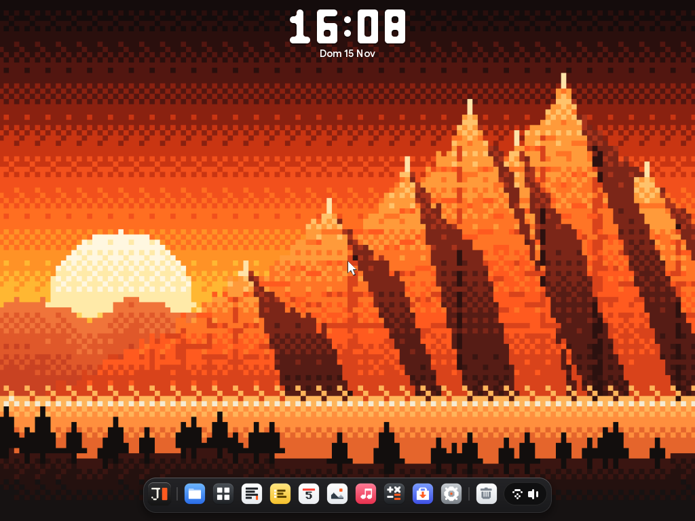

</div>

<br>

## Cos'è

justOS è un sistema operativo per PC x86-64 scritto in Rust, senza codice di
Linux, Unix o Windows: i loader, il kernel, il file system (JustFS), i driver,
le app di base e l'interfaccia sono nuovi. Nel sistema non ci sono crate di
terze parti, solo il compilatore Rust con `core` e `alloc`.

Sopra a questa base c'è uno strato di compatibilità con Linux, con un
compositor Wayland dentro il kernel: ci girano Firefox ESR, che è già
installato, GTK 3 e gli altri programmi Linux, in italiano; con Wine ci girano
anche molti programmi Windows. L'interfaccia è un dock che si trasforma
nell'isola di quello che sta succedendo, finestre a pixel morbidi, tema scuro
o chiaro, più monitor e una configurazione guidata al primo avvio.

È un progetto in sviluppo: [più sotto](#stato-del-progetto) c'è scritto con
onestà cosa funziona e cosa no.

## Funzioni

| | |
|---|---|
| **Avvio** | JustBoot: loader scritti da zero per BIOS (MBR e secondo stadio in assembly) e per UEFI (applicazione EFI in Rust). La stessa immagine parte da chiavetta USB, disco o CD live. |
| **Desktop** | Dock con menu di sistema e stato che diventa un'isola per notifiche, volume, programmi che si avviano, musica e timer; Applicazioni, centro di controllo, centro notifiche, ricerca globale anche dentro i file (Ctrl+Spazio), desktop virtuali, snap delle finestre, tema scuro e chiaro, HiDPI a 2×, più monitor. |
| **App** | File (con le anteprime delle immagini), Editor di testo, Note, Promemoria, Calendario, Orologio, Calcolatrice, Foto, Musica, Terminale, Monitor attività, Impostazioni, Info sistema, Cestino e un Negozio con giochi e programmi. |
| **Programmi Linux** | Eseguibili ELF statici e dinamici con la glibc di Debian, GTK 3, finestre Wayland, in italiano. **Firefox ESR è il browser di serie**, con l'audio e il dizionario italiano, e si presenta ai siti come Firefox per Windows, così propongono i programmi Windows da scaricare. I programmi con un file `.desktop` compaiono in Applicazioni. Un pacchetto `.deb` si installa con un doppio clic insieme alle dipendenze che gli mancano, scaricate dall'archivio di Debian e controllate con la sua firma; `deb get <nome>` installa per nome. |
| **Programmi Windows** | Un doppio clic su un `.exe`, `.msi` o `.bat` lo avvia con Wine 10, a 64 e a 32 bit, con finestre di justOS e l'audio. |
| **Hardware** | Driver a pacchetti (`.jdp`) che il kernel carica in base all'hardware trovato: dischi IDE, SATA, NVMe e virtio, USB, schede di rete Intel, Realtek, AMD e virtio, audio HD Audio e AC'97, lettori SD, ACPI con interprete AML per batteria, temperature e sospensione (in RAM, o s2idle sui portatili senza S3). |
| **Aggiornamenti** | A/B come su un telefono: la versione nuova va nell'altro slot di sistema e parte in prova; se non va, si torna a quella di prima. Le app del Negozio si aggiornano da un indice firmato. |
| **Installazione** | Dalla chiavetta o dal CD justOS si installa sul disco del computer, con scelta del disco, conferma e barra di avanzamento. |
| **Primo avvio** | Configurazione guidata in 10 passi: aspetto, tastiera, rete, account, nome del dispositivo, privacy e sfondo. |
| **Sicurezza** | Permessi come su un telefono: nessuna app ne riceve di base, e la prima volta che una ne vuole uno (una cartella, la rete, la fotocamera, il microfono, le notifiche) compare un popup con *Consenti*, *Solo questa volta* e *Non consentire*; in Impostazioni → Privacy si cambia idea. Vale anche per Firefox e i programmi Linux e Windows che usano il microfono. Password con sale e blocco automatico dello schermo. |

## Com'è

<table>
<tr>
<td width="33%">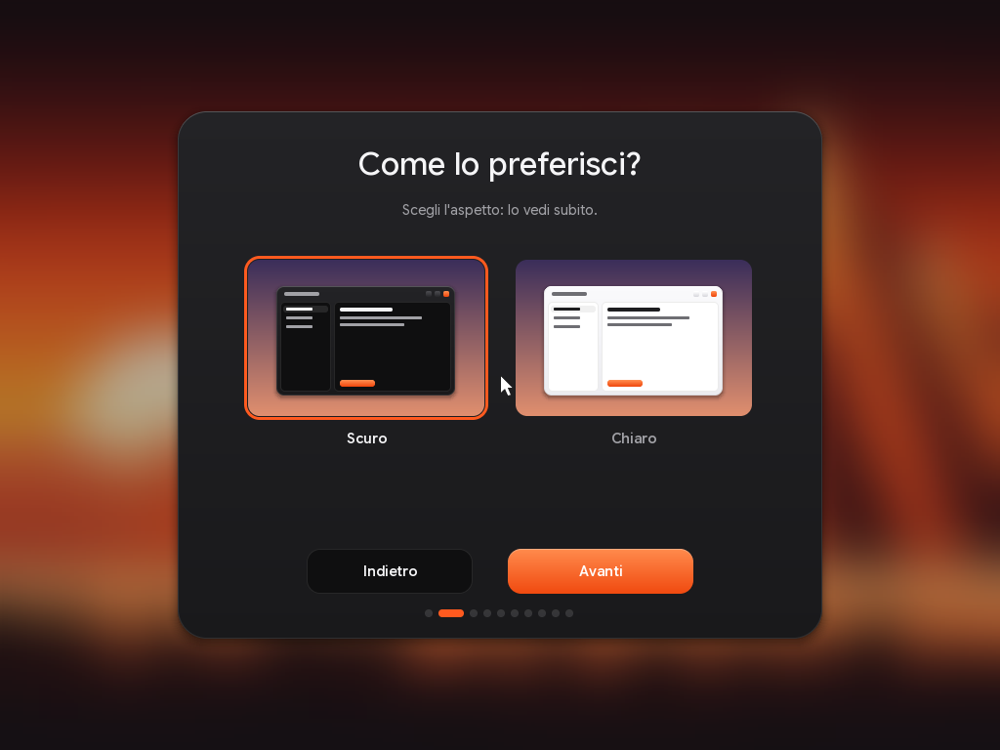<br><sub>Primo avvio: il tema, scuro o chiaro.</sub></td>
<td width="33%">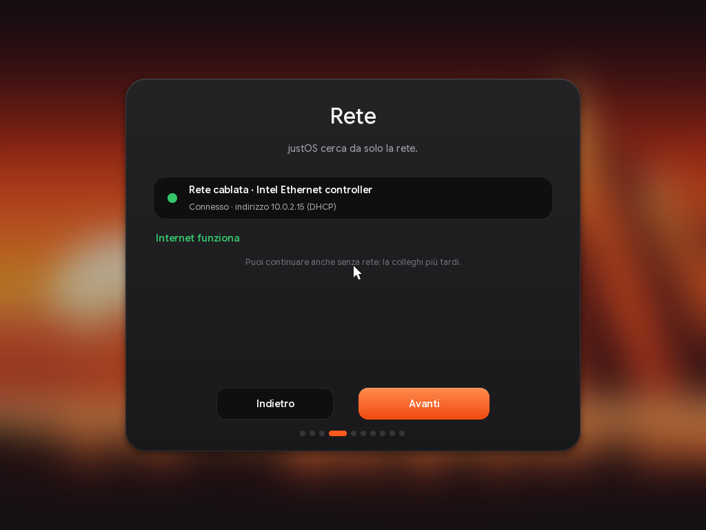<br><sub>Primo avvio: la rete.</sub></td>
<td width="33%"><br><sub>Primo avvio: lo sfondo.</sub></td>
</tr>
<tr>
<td>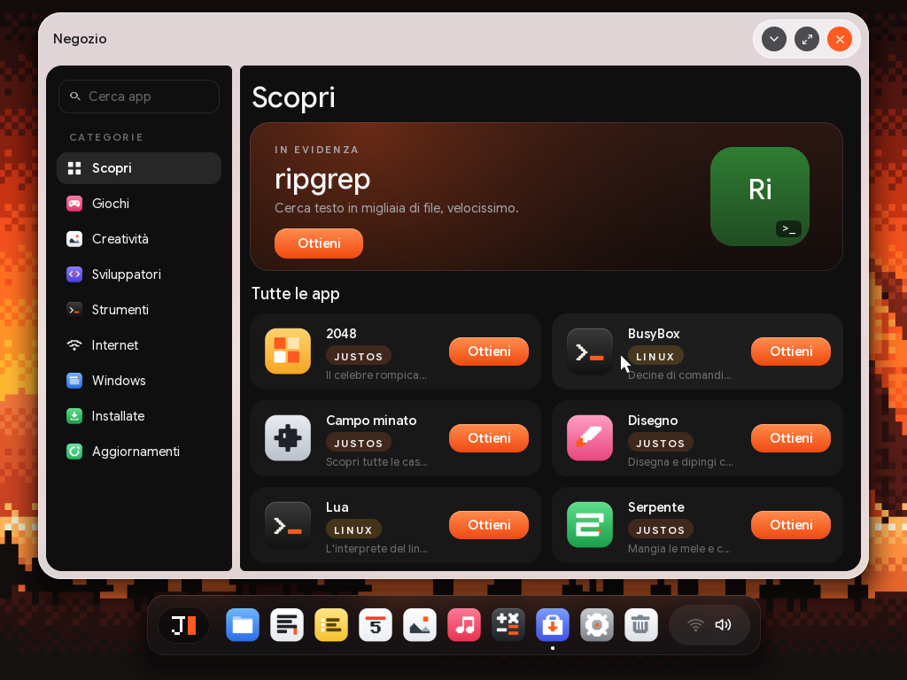<br><sub>Il Negozio.</sub></td>
<td>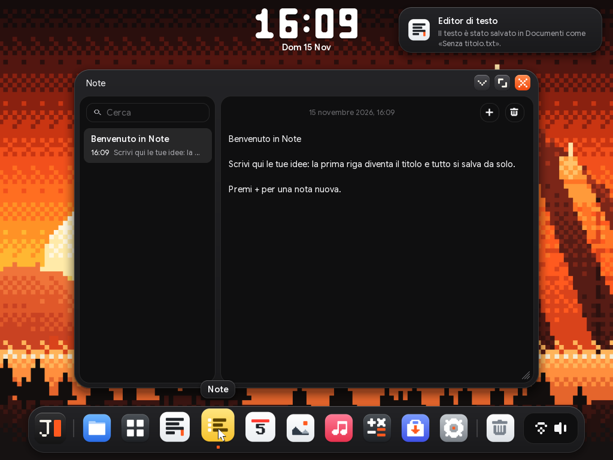<br><sub>Note, con una notifica.</sub></td>
<td>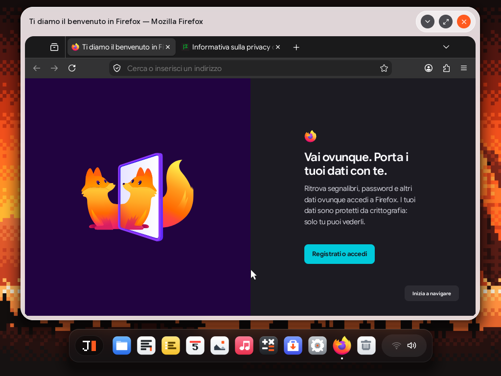<br><sub>Firefox ESR.</sub></td>
</tr>
<tr>
<td>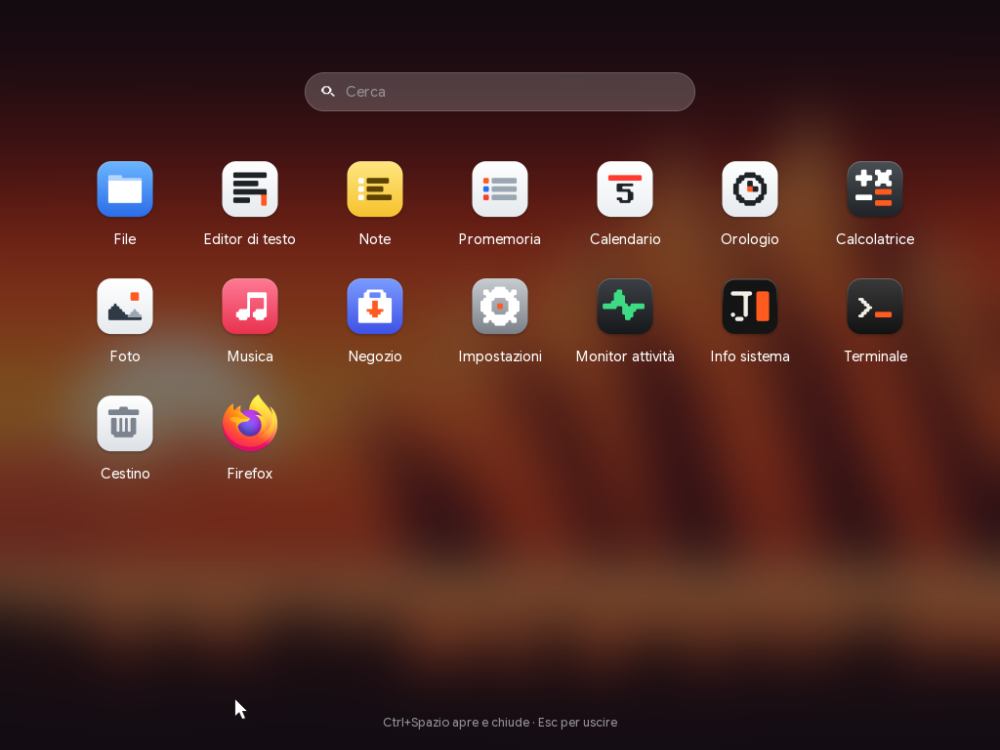<br><sub>Applicazioni (Ctrl+Spazio).</sub></td>
<td>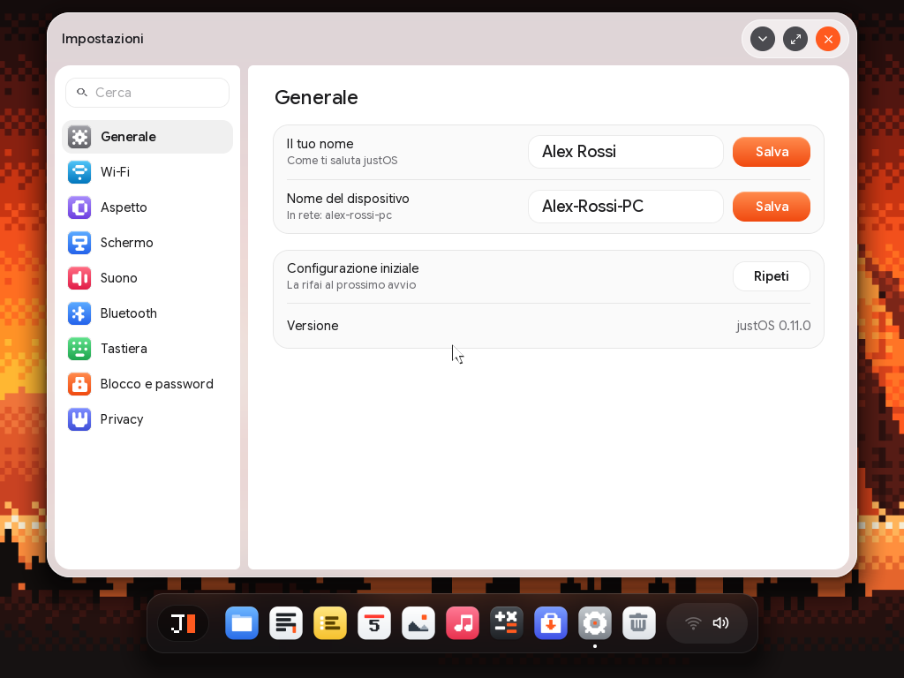<br><sub>Impostazioni, tema chiaro.</sub></td>
<td>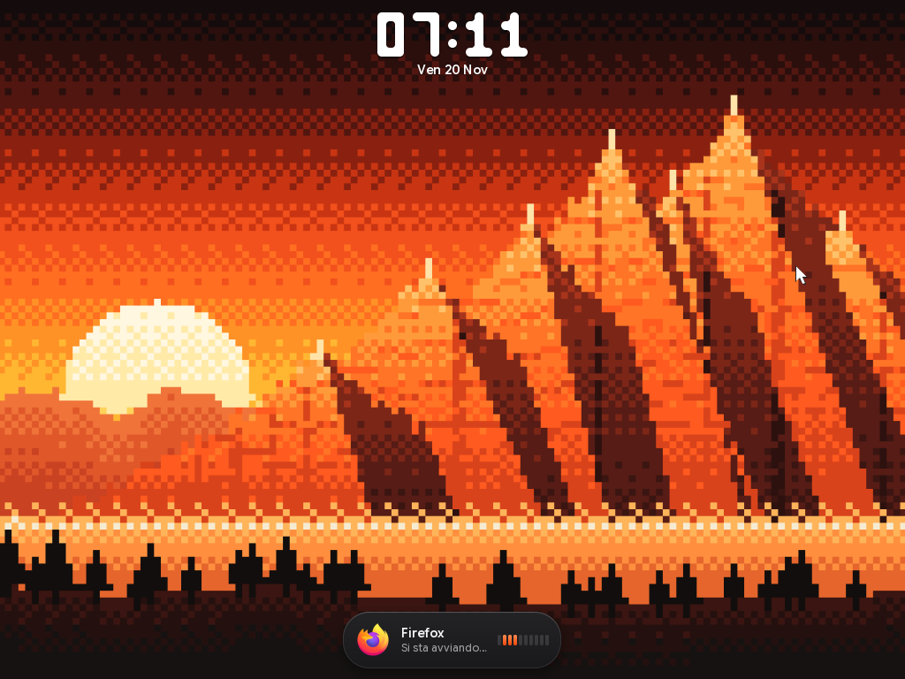<br><sub>Il dock diventa un'isola mentre Firefox si avvia.</sub></td>
</tr>
<tr>
<td>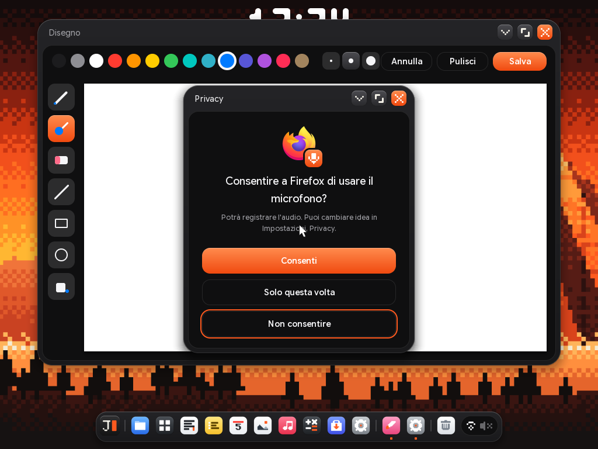<br><sub>Un permesso, chiesto come su un telefono.</sub></td>
<td>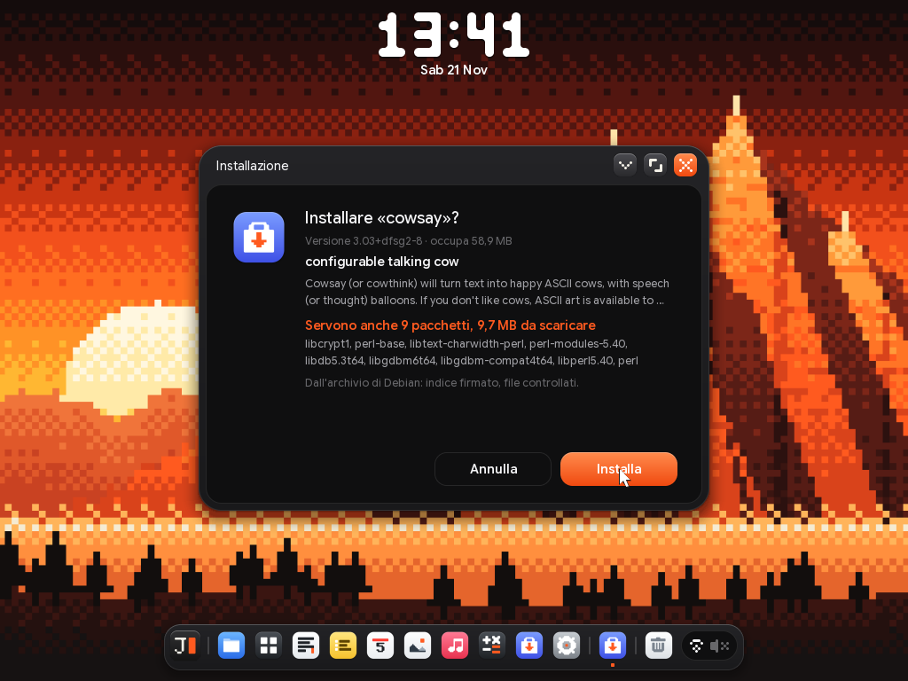<br><sub>Un .deb con le sue dipendenze da Debian.</sub></td>
<td></td>
</tr>
</table>

## Provalo

**Scaricalo.** Nella pagina delle
[versioni](https://github.com/justapps-it/justOS/releases/latest) ci sono
`justos-img.zip`, l'immagine di disco con Firefox e Wine (per una chiavetta USB
o una macchina virtuale), e `justos.iso`, il CD live senza Firefox e Wine.

**Oppure compilalo dai sorgenti.**

**Requisiti.** Rust stable (`rustup` installa da solo versione e target, grazie
a `rust-toolchain.toml`), `nasm`, `qemu-system-x86_64` e, per l'avvio UEFI,
OVMF. `make test-compat` usa anche `musl-gcc` e il gcc di MinGW-w64
(`gcc-mingw-w64-x86-64`), se ci sono. La prima volta `make` scarica dagli
archivi di Debian circa 380 MiB di pacchetti (restano in `build/debcache`).

```sh
git clone https://github.com/justapps-it/justOS.git
cd justOS

make            # l'immagine di disco build/justos.img (BIOS e UEFI), con Firefox e Wine
make run        # la avvia in QEMU
```

Altre forme:

```sh
make WINE=0          # l'immagine senza Wine, da 1 GiB invece che da 5 GiB
make iso             # il CD live build/justos.iso (senza Firefox e Wine: gira in memoria)
make run-uefi        # in QEMU con UEFI (anche run-q35, run-nvme, run-iso)
make run MEMORY=2G   # più memoria (di norma 1 GiB; Wine è provato con 2 GiB)
make SIZE=8G         # un'immagine di un'altra dimensione
```

L'immagine è da 5 GiB perché porta Firefox e Wine, e Wine al primo avvio
prepara il suo disco `C:`; è un file sparso, quindi sul disco occupa circa
1,8 GiB.

**Su una chiavetta USB.** Scrivi `build/justos.img` su una chiavetta da
almeno 8 GB con balenaEtcher, Rufus in modalità DD o `dd`. Parte con BIOS e con
UEFI; Secure Boot va disattivato. Su un PC vero tieni presente che molti
driver sono scritti dalla documentazione dei chip e provati in QEMU, non
ancora su molto hardware reale, e che sulle schede video vere lo schermo resta
nella risoluzione scelta dal firmware.

**Sul disco del PC.** Avviato dalla chiavetta o dal CD, justOS propone di
installarsi su un disco del computer: si sceglie il disco, si conferma che va
cancellato, una barra mostra l'avanzamento, poi si toglie la chiavetta e si
riavvia. Il disco da cui justOS sta girando non è mai fra quelli proposti; di
ogni disco si vede cosa contiene ("contiene Windows (NTFS)"), e "Cancella e
installa" funziona solo dopo aver spuntato "Ho capito, cancella questo disco".
**Tutto quello che c'è sul disco scelto viene cancellato**: justOS non si
installa accanto a Windows. Dal CD si installa il sistema del CD, senza Firefox
e Wine. I dettagli sono in
[docs/architettura.md](docs/architettura.md#installazione-su-un-disco-del-computer).

**Scorciatoie.**

| Tasti | Cosa fanno |
|---|---|
| **Ctrl+Spazio** | cerca app, file e impostazioni, e fa i conti |
| **F3** | vista d'insieme e desktop virtuali |
| **F11** | schermo intero |
| **Alt+Tab** · **Ctrl+Q** | passa alla finestra successiva · chiude quella in primo piano |
| **Ctrl+Alt+frecce** | aggancia la finestra a metà schermo, la ingrandisce, la ripristina |
| **Ctrl+Maiusc+L** · **Stamp** | blocca lo schermo · salva una schermata in Immagini |

Il Terminale (nel dock) ha una shell: `help` elenca i comandi; `dev` e `drv`
mostrano dispositivi e driver, `install <nome>` installa un programma dal
Negozio, `sysupdate` gestisce i due slot di sistema, `install-system list` elenca i
dischi su cui installare justOS.

## Stato del progetto

| Area | Stato | Note |
|---|---|---|
| Avvio BIOS e UEFI, kernel multiprocessore, JustFS | Funziona | Provato in QEMU; fino a 16 processori. |
| Desktop e app di base | Funziona | Dock, ricerca, desktop virtuali, tema scuro e chiaro, HiDPI. |
| Firefox ESR e programmi Linux | Funziona | Glibc di Debian, GTK 3, Wayland, in italiano, con l'audio e il microfono. Niente X11, niente accelerazione 3D (quindi niente WebGL), niente DRM Widevine. |
| Programmi Windows | In parte | Wine 10 a 64 e 32 bit, console e finestre. Con l'audio, anche dal microfono. Manca DirectX accelerato; i programmi grandi e recenti spesso non partono ancora. Non si garantisce che un dato programma funzioni. |
| Aggiornamenti A/B del sistema | Funziona | Provati in QEMU (`make test-update`), con ritorno indietro. |
| Hardware reale | In parte | Molti driver sono provati solo in QEMU; dettagli in [docs/driver.md](docs/driver.md#hardware-supportato). |
| App Android | In corso | Interprete Dalvik per programmi semplici e driver binder; le app vere non girano. |
| Wi-Fi | In corso | WPA2 e WPA3, ricerca delle reti e connessione automatica provate con un access point simulato (`make test-wifi`); il driver della Realtek RTL8852BE non è ancora finito, quindi su una scheda vera non funziona. |
| Bluetooth | Non ancora | Nessun driver. |
| Più monitor | In parte | Con virtio-gpu (macchine virtuali), alla stessa risoluzione e in fila; sulle schede video vere un solo monitor. |
| Accelerazione grafica | Non ancora | Il desktop è disegnato dal processore. |
| Fusi orari, indirizzo IP statico | Non ancora | |
| App macOS | No | I `.pkg` si aprono, ma i programmi Mach-O non si eseguono. |
| Installazione sul disco interno del PC | Funziona | Provata in QEMU (`make test-install`) con BIOS e UEFI, non ancora su hardware reale. Cancella tutto il disco scelto. |

I programmi Linux e Windows girano come programmi di sistema, fuori dalla
sandbox delle app di justOS. Cosa manca e in che ordine arriverà è nella
[roadmap](docs/roadmap.md).

## Documentazione

| Documento | Contenuto |
|---|---|
| [docs/architettura.md](docs/architettura.md) | avvio, memoria, kernel, JustFS, aggiornamenti A/B |
| [docs/gui.md](docs/gui.md) | desktop, finestre, temi, scorciatoie |
| [docs/compat.md](docs/compat.md) | programmi Linux, Windows (Wine), Java e Android, doppio clic |
| [docs/driver.md](docs/driver.md) | formato dei driver e hardware supportato |
| [docs/programmi.md](docs/programmi.md) | scrivere programmi per justOS |
| [docs/roadmap.md](docs/roadmap.md) | cosa c'è, cosa manca, in che ordine |

## Architettura in breve

```
  App di justOS      Firefox · programmi Linux      Programmi Windows (Wine)
        │                      │                            │
        │            strato Linux: ELF, glibc, socket,      │
        │            compositor Wayland, binder             │
        └──────────────────────┴────────────────────────────┘
                               │
  Kernel (Rust, 64 bit): memoria, scheduler, ACPI/AML, rete, desktop
        │                                   │
  Driver (.jdp, caricati da soli)      JustFS (volumi sys:, ram:, …)
        │
  JustBoot: BIOS (MBR + assembly) · UEFI (applicazione EFI)
```

<details>
<summary><b>Compilare e provare in dettaglio</b></summary>
<br>

I test girano tutti in QEMU, senza schermo:

```sh
make check          # test delle librerie e dello strumento host
make test           # una sessione di comandi scritta (anche test-uefi, test-iso)
make test-drivers   # un avvio per ogni disco, scheda di rete, controller USB e lettore SD
make test-audio     # suoni su ogni scheda audio emulata
make test-display   # cambio di risoluzione su ogni scheda video emulata
make test-acpi      # pulsante di accensione, batteria, sospensione e risveglio
make test-update    # aggiornamento nell'altro slot, prova, conferma, ritorno indietro
make test-install   # installazione su dischi finti (SATA, NVMe, virtio) da disco, chiavetta e CD
make test-compat    # programmi Linux, Windows, Java e Android
make test-linux     # lo strato Linux: processi, segnali, socket, binder
make test-wayland   # il compositor Wayland
make test-gtk       # un programma GTK 3 con il tema di justOS
make shots          # usa l'interfaccia e salva le schermate
make shots-install  # le schermate dell'installazione, con il tema scuro e chiaro
```

I test avviano un'immagine senza Wine (`build/justos-test.img`, la costruiscono
da soli) oppure quella data con `IMAGE=`; gli script in `scripts/` accettano
qualunque immagine. Su GitHub il workflow [Build](.github/workflows/build.yml)
esegue `make check` e costruisce immagine e CD a ogni push.

</details>

<details>
<summary><b>Struttura del repository</b></summary>
<br>

| Percorso | Contenuto |
|---|---|
| `boot/bios/`, `boot/uefi/` | JustBoot per BIOS e per UEFI |
| `system/kernel/` | il kernel, con l'interfaccia grafica (`src/gui`) e lo strato Linux |
| `system/drivers/` | i driver, uno per cartella, ognuno con il suo `driver.manifest` |
| `system/apps/` | i programmi, tra cui `winrun` (programmi Windows semplici) e `dalvik` (Java e Android) |
| `system/store/` | le app del Negozio, con icona e scheda |
| `system/libs/` | le librerie: ABI dei driver, programmi, finestre, disegno, immagini, JustFS, USB, virtio, TLS, Dalvik |
| `tools/justtool/` | strumento host: crea pacchetti, immagini e CD, legge e scrive volumi JustFS |
| `tools/assets/` | i generatori di caratteri, icone, sfondi, suoni e del banner |
| `rootfs/` | i file del volume di sistema |
| `scripts/` | i test automatici in QEMU |
| `docs/` | la documentazione |

</details>

## Contribuire

Segnalazioni e proposte sono benvenute: apri una issue o una pull request su
[justapps-it/justOS](https://github.com/justapps-it/justOS). Prima di
inviare una modifica esegui `make check` e, se tocchi il kernel o i driver, i
test che la riguardano (`make test`, `make test-drivers`, `make test-compat`).
Leggi la [roadmap](docs/roadmap.md) per sapere cosa serve di più.

## Licenza

Copyright (C) 2026 Matthias Peterlini <https://matthiaspeterlini.tech>

justOS è software libero: puoi ridistribuirlo e/o modificarlo secondo i
termini della GNU General Public License, nella versione 3 o (a tua scelta) in
una qualsiasi versione successiva (GPL-3.0-or-later). È distribuito nella
speranza che sia utile, ma SENZA ALCUNA GARANZIA. Il testo completo è in
[LICENSE](LICENSE).

I caratteri Google Sans Flex e DejaVu Sans Mono hanno le loro licenze libere
(SIL OFL), in `system/kernel/assets/LICENSES.md`; le foto degli sfondi sono di
Unsplash (licenza Unsplash), con gli autori in
`rootfs/system/gui/wallpapers/CREDITS.txt`.
